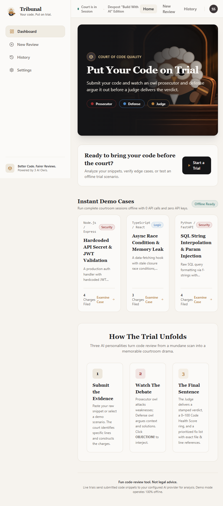
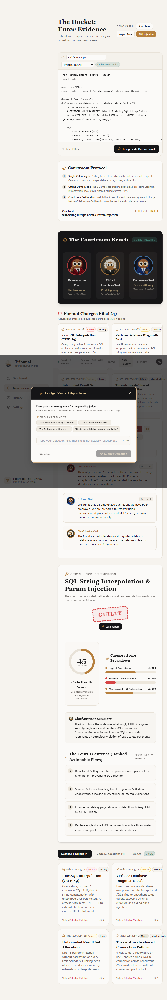
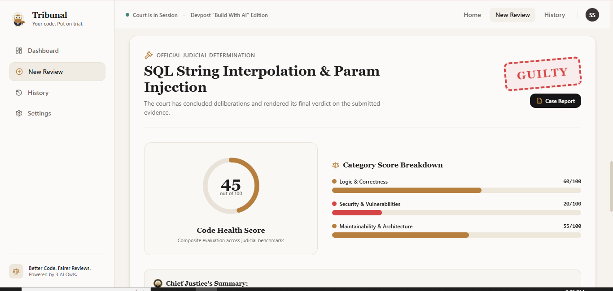
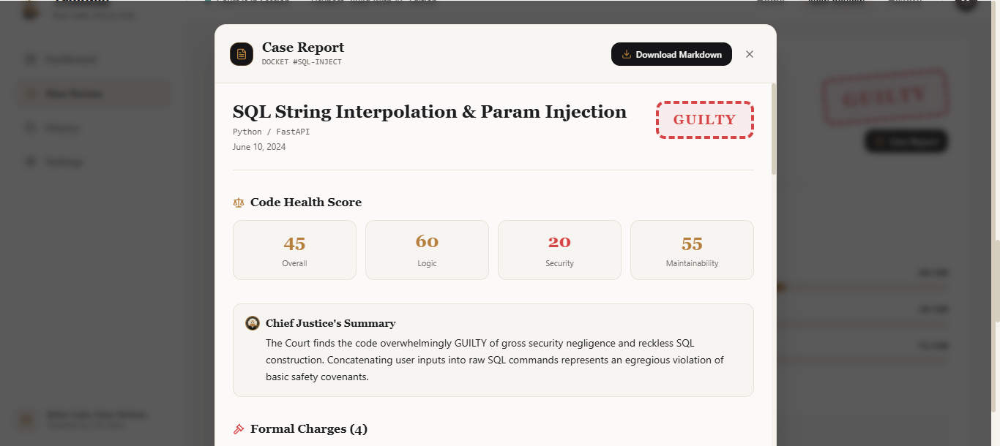

# ⚖️ Tribunal

### *Your code. Put on trial.*

**Live demo:** https://tribunal-silk.vercel.app

Tribunal is a web app where your code stands trial. Three owl characters argue over it in a courtroom: a **Prosecutor Owl** who attacks weaknesses, a **Defense Owl** who defends the code, and a **Chief Justice Owl** who delivers the verdict. You get a Code Health Score and a ranked list of fixes, in a format that is actually fun to read.

Built solo by **Syeda Shehla** for the [Build With AI: Basics](https://learn-ai-basics.devpost.com/) hackathon on Devpost.

---

## Screenshots

### Dashboard


### Courtroom debate and OBJECTION!


### Verdict


### Case Report


---

## How it works

1. **File a case**: paste your code, or pick a Demo case (Auth Leak, Async Race, SQL Injection).
2. **Charges**: findings are listed and tagged **Logic**, **Security** or **Maintainability**, each with a score.
3. **The debate**: Prosecutor Owl and Defense Owl argue it out automatically.
4. **OBJECTION!**: an objection interrupts the debate (screen shake + sound), and the Chief Justice rules *Sustained* or *Overruled*.
5. **Verdict**: a verdict stamp, a Code Health Score ring, and ranked fixes as the "Sentence".
6. **Explore**: tabs for Detailed Findings, Code Suggestions and Appeal.
7. **History and report**: past cases are saved in your browser, and each case opens as a Case Report that can be downloaded as Markdown.

## Features

- Three distinct owl characters: Prosecutor (crimson), Defense (blue), Chief Justice (gold)
- Findings tagged Logic / Security / Maintainability with scores
- Auto-playing courtroom debate with an OBJECTION! moment
- Code Health Score ring and ranked fixes
- Case History saved in `localStorage`
- Case Report modal with Markdown download
- **Demo Mode**: fully offline, never rate-limited, works instantly
- Server-side rate limiting for live mode

## Tech stack

- **Next.js** (App Router) + **TypeScript**
- **Tailwind CSS**
- **Google Gemini** (`gemini-3.8-flash`) with **zod**-validated JSON output
- Fonts: Playfair Display + Inter
- Deployed on **Vercel**
- No database, no login

LLM calls happen **server-side only**, so the API key is never exposed to the browser. Each case uses one main Gemini call, plus a small extra call per objection.

## Run locally

```bash
git clone https://github.com/shehla-codex/tribunal.git
cd tribunal
npm install
```

Create a `.env.local` file in the project root:

```env
LLM_PROVIDER=your_provider
LLM_MODEL=gemini-3.8-flash
LLM_API_KEY=your_key_here
```

Then start the dev server:

```bash
npm run dev
```

Open http://localhost:3000. Demo Mode works even without an API key.

## Scope

Intentionally left out to keep the project focused: GitHub URL mode, live Appeal (the tab shows "Live Appeal Coming Soon"), database, authentication, PDF export.

## Hackathon docs

Planning documents are in the [`devpost/`](devpost/) folder: `scope.md`, `prd.md`, `spec.md`.

## Credits

No third-party game or film assets are used.

---

Made by **Syeda Shehla** · [@shehla-codex](https://github.com/shehla-codex)